:::{.callout-note title="Section Overview"}

⏰ **Time Estimation:** 20 minutes  

💬 **Learning Objectives:**

1. Start a transcriptomics app job in UCloud for the next lessons in data analysis
:::

<span style="font-size:30px;"> Get started on UCloud to perform data analysis<span>

## Submit the job in UCloud

Access [UCloud](https://cloud.sdu.dk) with your account and choose the project `Sandbox RNASeq Workshop` where you have been invited.

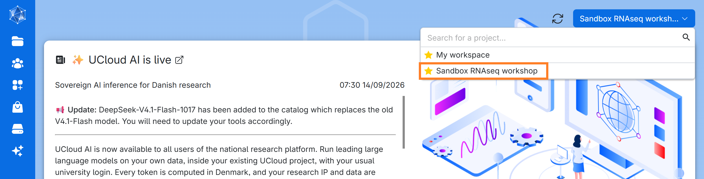

Click on `Applications` on the left-side menu, and go to `Courses` > `Health Data Science Sandbox` > `Transcriptomics Sandbox` and select it:

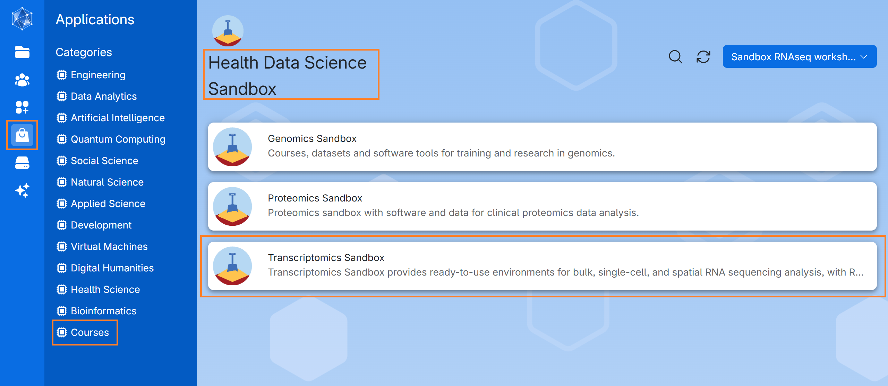

Once you are in the `Transcriptomics Sandbox`, input appropriate parameters to run a job. Here, you will find a set of recommended values to choose. 

:::{.callout-warning}
**Always ensure that you are in the "sandbox_bulkRNAseq" workspace.** You can select the workspace by clicking on the down arrow (**&or;**) icon to open a dropdown menu.
:::

Let's take a look at the parameters we have chosen. We have given it a `Job name`, `Hours`, `Machine type` as well as a `Mandatory Parameter` `Select a module`. We have selected the module `Introduction to bulk RNAseq analysis in R`. **This module will load the materials necessary to follow the next lessons. It will also contain a data file containing the preprocessing results** so that you can go through analyses without processing raw reads with our pipeline, which takes several hours. You can test out running the pipeline by following our guide [here](https://hds-sandbox.github.io/bulk_RNAseq_course/develop/04b_pipelines.html) and then mounting the data from your own drive (independently of our workshops).

To set up a job for using the bulk RNA-seq module in our Transcriptomics app, you need to do the following:

1. Check the App version (we recommend using the latest).
2. Note that Documentation is available (though it redirects you to this website).
3. If you have previously run the app, you can import job parameters from that run. We'll get to that later.
4.  Set your job name (pick something original / with your initials!), your hours of use (you can top up later as the job runs, but give a good estimate), and your machine type (if you simply want to do the downstream analysis, you only need 1 CPU).
5. Add folders containing any material that your job needs to run. For first time use, without your own data, you don't need a folder. However, we recommend making your own working directory in your member files (see my bulk_ARM example below) and eventually copying files to and editing files from there (e.g. `bulk_<YourInitials>`).
6. Select the module you want to use. In this example, we select 'Intro to bulk RNAseq with Rstudio'.
7. Then you can submit your job.

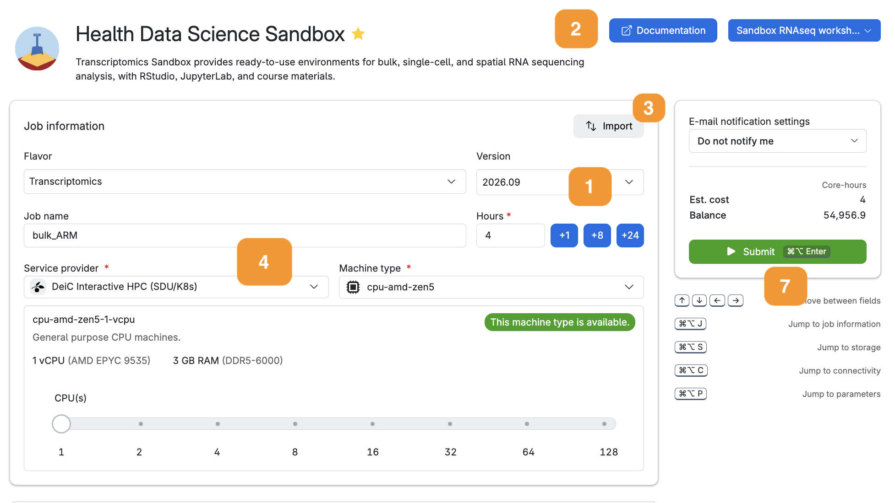
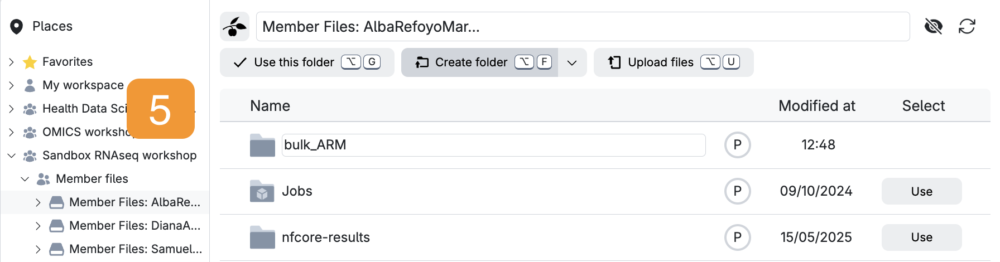
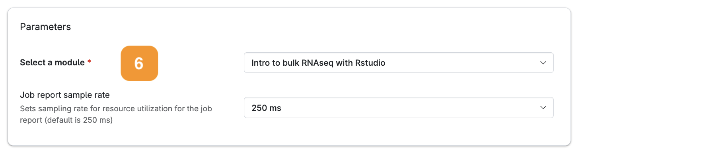

Now, you are ready to run the app by clicking on the button on the right column of the screen (`submit`).

Next, wait until the screen looks like the figure below. This process usually takes a few minutes. You can always come back to this screen via the `Runs` button in the left menu on UCloud. From there, you can add extra time or stop the app if you no longer need it.

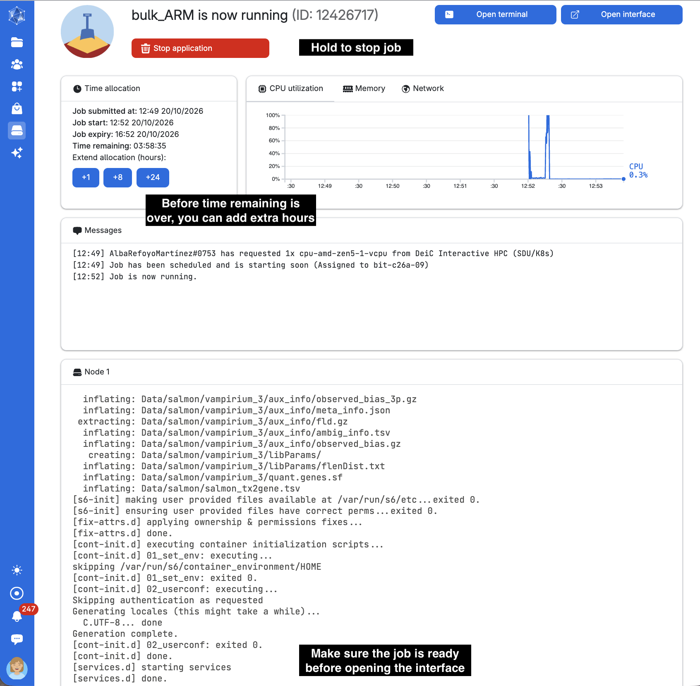

Click on `open interface` on the top right-hand side of the screen. You will start Rstudio through your browser!

On the lower right side of Rstudio, in the file explorer, you should see a couple of folders `Notebooks`, `Data`, `Scripts` and `Results`. Here you will find the materials of the course. If you have added your own folder `bulk_<YourInitials>`, it will also listed here.

Let’s move all the course material into your personal folder so we can reuse it in future sessions without downloading a fresh copy each time. You can do this either from the terminal in RStudio (option A. in the image below) or with option B.

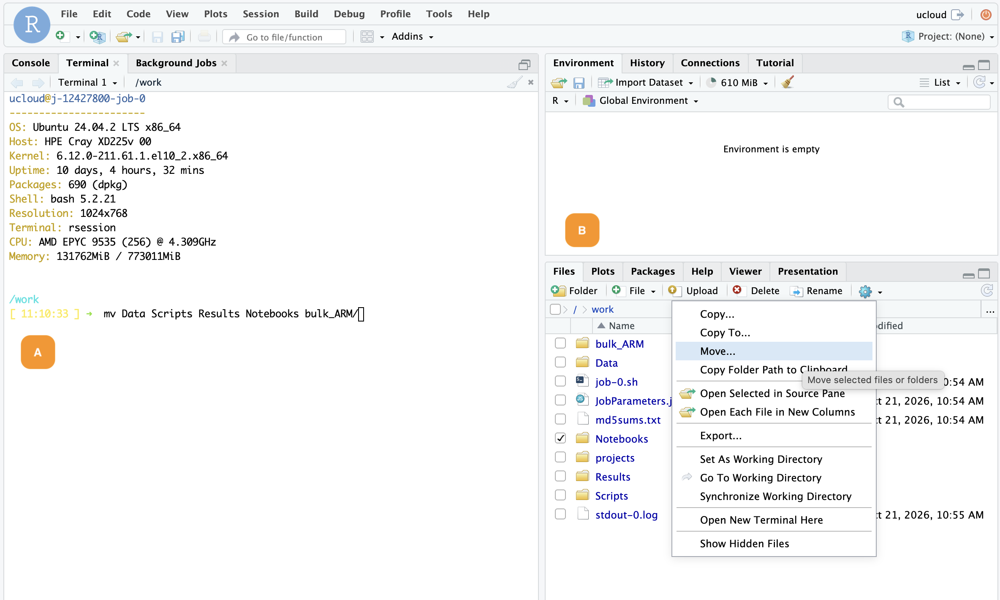

```.bash
mv Data Scripts Results Notebooks bulk_ARM/
```

Then, navigate to the Notebooks folder (bulk_XXX > Notebooks). You are ready to start analysing your data! 

Open one of the notebooks and test that you can run it. 

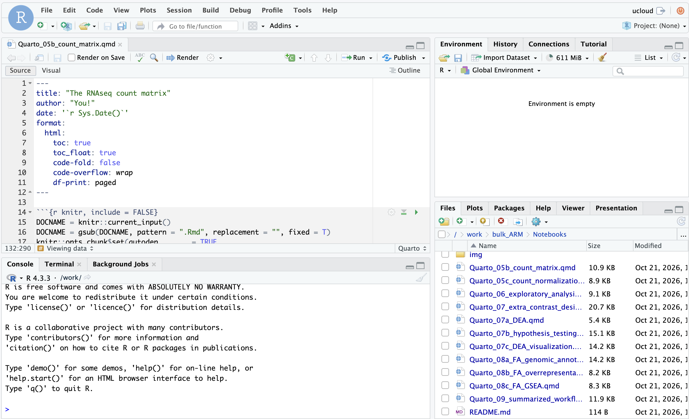

:::{.callout-warning collapse="true"}
# Does your session not seem to be starting properly?
If your 'Messages' window indicates the job has started, but your `open interface` button is not clickable, hit refresh. If it IS clickable, but the new tab that opens is just spinning without showing an interface, wait a few seconds and then hit refresh. It's probably there, but UCloud just takes a moment sometimes to gather its thoughts.
:::

## Stopping the app

When you are finished, go to `Runs` > `Running jobs` in UCloud and click on the `Job name` you want to stop if you have several running. It is important to stop the job to prevent it from using unnecessary resources. Here, you can also click on the job and add extra time!

## Saved work

After running a first work session, everything that you have created, including the scripts and results of your analysis, will be saved in your own personal folder you created.

1. Your material will be saved in a volume with your username, that you should be able to see under the menu `Files`. 

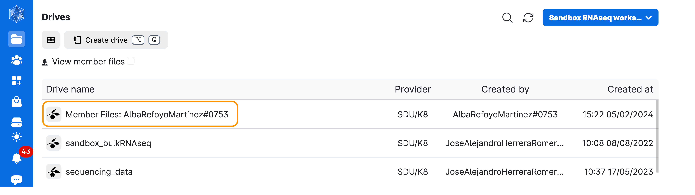

2. Go to Member Files: YourName... 

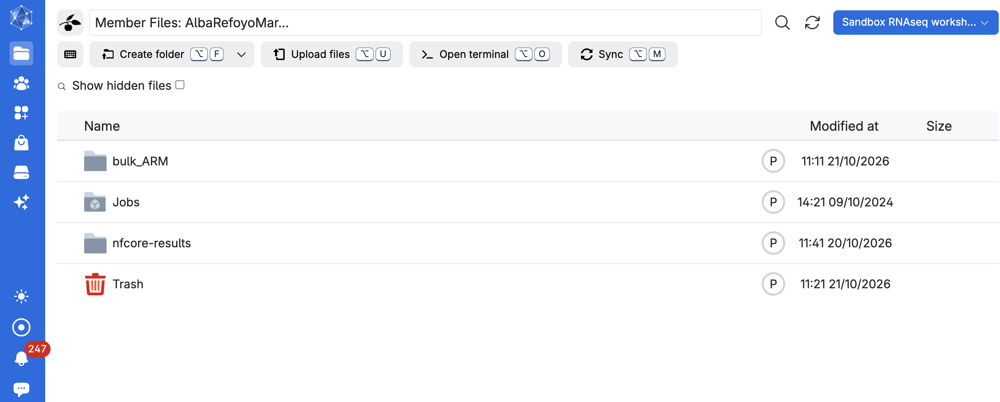

:::{.callout-warning collapse="true"}
# Did you not move the course material to your own folder?

Then, everything that you have created, including the scripts and results of your analysis, will be saved in your own personal *"Jobs"* folder. Inside this folder there will be a subfolder called *Transcriptomics Sandbox*, which will contain all the jobs you have run with the Transcriptomics Sandbox app. Inside this folder, you will find your folder named after the job name you gave in the previous step or an ID attached to that session. 

1. Go to `Jobs → Transcriptomics Sandbox → <Job name> → `. Here you will find the Data, Notebooks, and all the other folders needed for the exercises. 

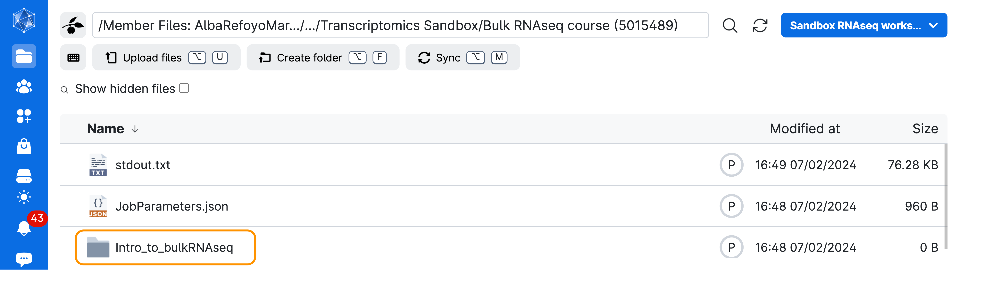

### Starting from in-progress work

If you want to keep working on your previous results, it makes sense to copy the course material to your own working directory, and reload this folder for new jobs. If this exact folder with this exact name is available in the root directory of your job workspace, the app will not download fresh directories, and you will instead have your own edited/editable files.

To copy the directory, complete the following steps:

1. Go to `Jobs → Transcriptomics Sandbox → <Job name> → `
2. Click ONCE to select `Data`, `Notebooks`, `Scripts` and `Results`
3. Click 'Copy to...'
4. Click on your root member files directory
5. Select 'Copy to' the custom working directory you made (you can `Create folder` now if you haven't previously)

:::{.callout-tip}
# Ta-da
**Now you will always have your own, writeable copy of this directory... AS LONG AS YOU LOAD IT IN YOUR NEXT JOB!**
:::

:::

## Restarting the Rstudio session

:::{.callout-warning}
**Remember to save your notebooks while working in an interactive session.** Otherwise you might lose edits to your .qmd files.
:::

You will need to mount the course materials saved in your own member files. Open the `Transcriptomics Sandbox` application again. Go to `Storage` and select the following folders: `Data`, `Scripts`, `Notebooks` and `Results`.

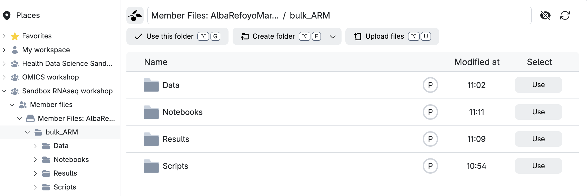

Make sure your Storage window looks as follows: 

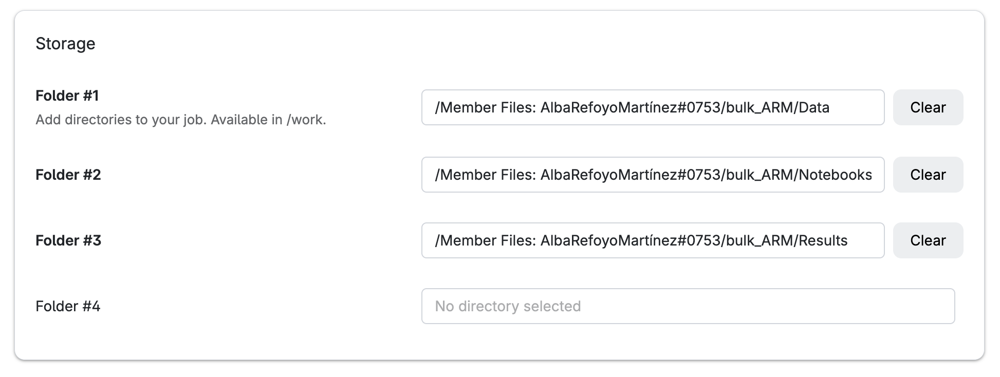

All other settings should be the same as the first time.

Before you `Open Interface`, make sure that the job stats says using your own data. 

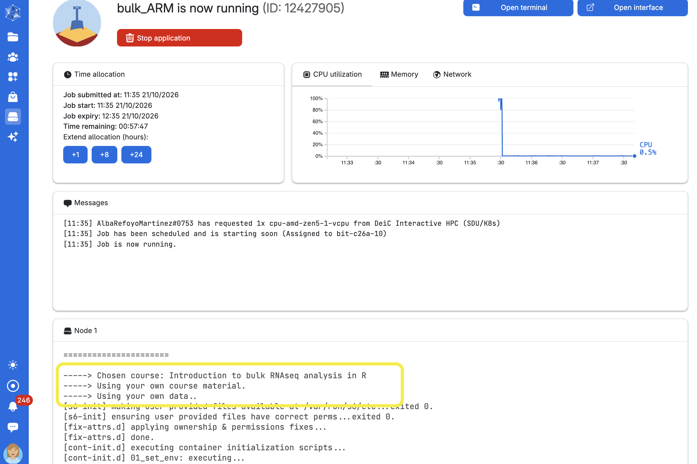


### Reusing old job parameters

The very easy way (perhaps after your job has accidentally run out of time / disconnected due to a UCloud blip) is to simply hit 'Run application again'.

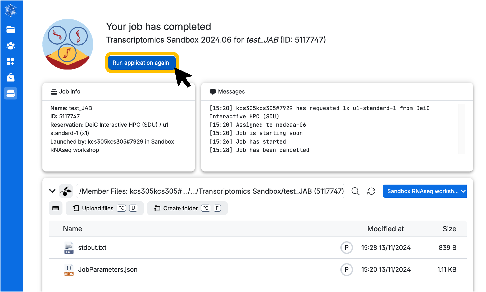

Other moderately easy methods include:
A) accessing the `Runs` menu, where you can see completed, pending, and active jobs and select one to restart via `Run application again`.
B) accessing the Transcriptomics Sandbox App job setup window, selecting `Import parameters`, and then importing from your last job. You can also select a `JobParameters.json` file if one has been shared with you to replicate parameters for a specific task.
